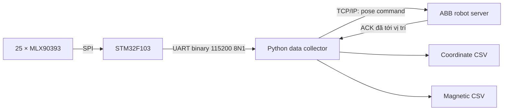
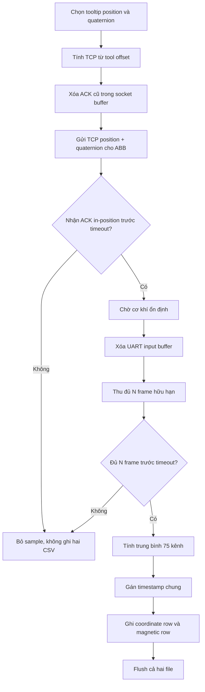

# Tổng quan hệ thống thu thập dữ liệu bằng Robot Arm

## 1. Mục tiêu và phạm vi

Phần mềm trong `RobotArm_CollectData` điều phối robot ABB và mảng 25 cảm biến MLX90393 để tạo các cặp dữ liệu:

```text
(vị trí nam châm, hướng nam châm) ↔ (75 thành phần từ trường của mảng sensor)
```

Tài liệu này mô tả pipeline chung cho các quỹ đạo, không phụ thuộc hình dạng quỹ đạo cụ thể. Mỗi sample hợp lệ gồm pose/hướng đã ra lệnh cho robot và vector từ trường trung bình của 25 sensor tại pose đó.

## 2. Kiến trúc truyền thông



Máy tính chạy một trong các script `robot_ABB_*.py`. Chức năng chung về parser UART, kiểm tra dữ liệu, ACK, tham số dòng lệnh và bảo vệ output nằm trong `collection_utils.py`.

### 2.1 Kênh TCP với robot ABB

Thông số mặc định trong các script:

| Thông số | Giá trị mặc định |
|---|---:|
| Robot IP | `192.168.125.1` |
| TCP port | `2500` |
| ACK timeout | 20 s |
| ACK hợp lệ | `[DONE]`, `[REACHED]`, `[IN_POSITION]` hoặc `[1]` |

Pose được gửi dưới dạng ASCII:

```text
[x_mm,y_mm,z_mm];[qw,qx,qy,qz]
```

Trong đó position gửi cho robot là TCP position tính bằng millimeter; quaternion dùng quy ước scalar-first `(qw,qx,qy,qz)` và được chuẩn hóa trước khi truyền. Regex ACK có thể thay bằng `--ack-regex`, nhưng token phải thật sự biểu thị robot đã tới vị trí, không chỉ là xác nhận đã nhận command.

### 2.2 Kênh UART với STM32

| Thông số | Giá trị |
|---|---:|
| Baud rate | 115200 bit/s |
| Format | 8N1, không flow control |
| Frame | `AA BB` + 75 `float32` + `CC DD` |
| Payload size | 300 byte |
| Tổng frame | 304 byte |
| Byte order | little-endian |
| Đơn vị | mT |

Thứ tự 75 giá trị:

```text
S1_Bx, S1_By, S1_Bz, ..., S25_Bx, S25_By, S25_Bz
```

Parser tìm header `AA BB`, đọc đúng 300 byte payload và kiểm tra tail `CC DD`. Khi byte bị mất hoặc tail sai, parser tiếp tục tìm header kế tiếp để tái đồng bộ.

## 3. Biểu diễn hình học

### 3.1 Tooltip, TCP và tool offset

Quỹ đạo được định nghĩa theo vị trí tooltip/nam châm `p_tip`, trong khi robot nhận TCP position. Với tool offset `o` biểu diễn trong tool frame và ma trận quay `R(q)`:

```text
p_TCP = p_tip - R(q) o
```

Cấu hình hiện tại:

```text
o = [-3.0, 0.0, 98.5] mm
```

Vì TCP thay đổi theo cả position và orientation, kiểm tra khoảng cách chỉ trên tooltip là chưa đủ. Trước khi kết nối robot, script tạo toàn bộ chuỗi TCP dự kiến và kiểm tra:

```text
||p_TCP,k - p_TCP,k-1||₂ ≤ max_step_mm
```

Giới hạn mặc định là 60 mm. Nếu tooltip path hoặc commanded TCP path vượt giới hạn, chương trình dừng trước khi mở TCP/UART. `--dry-run` thực hiện các phép kiểm tra này mà không điều khiển robot.

### 3.2 Hướng nam châm

Vector trục nam châm trong tool frame được quy ước:

```text
m_tool = [1, 0, 0]
```

Vector hướng trong world/base frame được tính:

```text
m_world = R(q) m_tool = [mx, my, mz]
```

`m_world` là vector đơn vị không thứ nguyên. Các script có thể tính thêm pitch/yaw để quan sát, nhưng vector `(mx,my,mz)` là biểu diễn ít mơ hồ hơn và được lưu trong coordinate CSV.

## 4. Chu trình thu một sample

Trình tự chung cho mỗi pose là:



Chi tiết:

1. Lấy tooltip position và quaternion từ quỹ đạo đã kiểm tra.
2. Tính TCP bằng tool offset và gửi pose qua TCP.
3. Chờ ACK in-position tối đa 20 s.
4. Sau ACK, chờ settling delay được đặt trong script. Các giá trị hiện tại nằm khoảng 1.5–2.5 s tùy kiểu chuyển động; giá trị dùng trong thí nghiệm phải được ghi vào metadata/report.
5. Xóa dữ liệu UART cũ để các frame trung bình thuộc thời gian sau khi robot đã ổn định.
6. Thu đúng `N` frame hoàn toàn hữu hạn; mặc định `N=5` (`--samples 5`).
7. Tính trung bình số học từng kênh.
8. Gán cùng `sample_id` và `captured_at_unix_s` cho hai dòng CSV.
9. Ghi và flush cả coordinate CSV lẫn magnetic CSV.

Nếu ACK timeout hoặc kết nối robot đóng, sample bị bỏ. Frame UART chứa NaN/Inf bị loại; sample chỉ bị bỏ khi không thu đủ `N` frame hợp lệ trước timeout. Trong các trường hợp đó, chương trình không chủ động ghi dòng tương ứng vào hai CSV.

## 5. Xử lý và trung bình dữ liệu từ trường

Gọi `B(s,a,k)` là giá trị của sensor `s`, trục `a ∈ {x,y,z}`, tại frame UART thứ `k`. Với `N` frame hợp lệ:

```text
                 N
B̄(s,a) = (1/N)  Σ B(s,a,k)
                k=1
```

Điều kiện chấp nhận nghiêm ngặt:

- Mỗi frame phải có đúng 75 giá trị.
- Tất cả 75 giá trị của tất cả `N` frame phải hữu hạn.
- Không dùng `nanmean`; một frame chứa bất kỳ NaN/Inf nào bị loại hoàn toàn.
- Sample chỉ hợp lệ nếu vẫn thu đủ đúng `N` frame trước acquisition timeout mặc định 2 s.
- Sau khi xếp chồng `N` frame, nếu cả Bx, By, Bz của một sensor không đổi bit-for-bit trong toàn cửa sổ, chương trình phát cảnh báo frozen sensor. Đây là cảnh báo, không tự động loại sample, vì trường tĩnh và nhiễu lượng tử thấp cũng có thể tạo giá trị lặp.

Mỗi frame UART hợp lệ đã được firmware tạo từ đúng 5 lượt đo raw hợp lệ trên mỗi sensor, lấy trung bình, đổi sang mT và lọc Kalman riêng cho từng kênh. START/RM lỗi được retry một lần trong từng lượt. Nếu một sensor vẫn không đủ 5/5 lượt, firmware phát NaN cho cả XYZ của sensor đó để PC loại frame; giao thức vì thế không che giấu phép trung bình thiếu. Sau đó PC tiếp tục lấy trung bình `N` frame UART (mặc định `N=5`). Vì Kalman làm các frame liên tiếp tương quan, không nên diễn giải lớp trung bình thứ hai là trung bình của 25 mẫu raw độc lập hay mặc định áp dụng quy luật giảm nhiễu `1/√25`.

Với riêng 5 khoảng chờ 12 ms, thời gian truyền 304 byte ở 115200 8N1 (khoảng 26.4 ms), delay 10 ms và overhead SPI, tốc độ phát hiện tại bị chặn trên xấp xỉ 10 frame/s. Vì vậy 5 frame phía PC bao phủ ít nhất khoảng 0.5 s; tốc độ thực cần đo trên phần cứng thay vì dùng ước lượng 18–21 frame/s của phiên bản firmware chỉ đo một lượt cho mỗi frame.

Phép mean dùng accumulator `float64` để giảm sai số cộng, sau đó kết quả được cast về `float32` trước khi ghi CSV. Pipeline hiện chỉ lưu vector trung bình; các frame thành phần, standard deviation và uncertainty của từng sample không được lưu. Nếu report cần đánh giá độ lặp lại tại từng pose, nên mở rộng output để lưu `std`, số frame lỗi hoặc raw frames.

## 6. Cấu trúc dữ liệu đầu ra

Mỗi lần chạy tạo hai CSV. Nếu không truyền đường dẫn, file tọa độ được lưu trong `Data set/Coordinates/` và file từ trường được lưu trong `Data set/Magnetic/`. File hiện có không bị ghi đè nếu thiếu cờ `--overwrite`.

### 6.1 Coordinate CSV

Các cột chung:

| Cột | Đơn vị | Ý nghĩa |
|---|---|---|
| `sample_id` | không thứ nguyên | Khóa ghép với magnetic CSV |
| `captured_at_unix_s` | s từ Unix epoch | Timestamp máy tính sau khi hoàn tất acquisition |
| `x_m`, `y_m`, `z_m` | m | Tooltip position đã ra lệnh |
| `mx`, `my`, `mz` | không thứ nguyên | Vector đơn vị hướng nam châm trong world frame |

Một số script lưu thêm `pitch_deg`, `yaw_deg`. Tọa độ quỹ đạo và lệnh robot được tính bằng mm, nhưng CSV chuẩn hóa position sang meter bằng phép chia 1000.

### 6.2 Magnetic CSV

Magnetic CSV có 77 cột:

```text
sample_id, captured_at_unix_s,
sensor_1_Bx_mT, sensor_1_By_mT, sensor_1_Bz_mT, ...,
sensor_25_Bx_mT, sensor_25_By_mT, sensor_25_Bz_mT
```

Các cột từ trường có đơn vị mT. Thứ tự là sensor-major và trùng với payload firmware.

### 6.3 Ghép hai file

Hai file phải được ghép bằng `sample_id`, không ghép chỉ theo số dòng. Khi robot hoặc sensor timeout, `sample_id` có thể bị khuyết nhưng các sample còn lại vẫn hợp lệ. Timestamp được ghi giống nhau cho cặp row tương ứng.

Việc ghi hai file là hai thao tác liên tiếp chứ không phải transaction nguyên tử. Nếu process hoặc máy tính dừng đúng giữa hai lệnh ghi, hai file có thể lệch một dòng. Sau thí nghiệm phải kiểm tra số dòng, tập `sample_id` và timestamp trước khi phân tích.

## 7. Đồng bộ thời gian và ý nghĩa timestamp

Pipeline là đồng bộ bằng phần mềm theo sự kiện:

1. Robot báo đã tới pose.
2. Chờ settling delay.
3. Xóa UART buffer.
4. Thu và trung bình `N` frame mới.

Không có hardware trigger chung giữa robot controller và STM32. `captured_at_unix_s = time.time()` được lấy **sau khi đã thu xong N frame**, nên nó gần thời điểm cuối cửa sổ đo hơn thời điểm giữa. Coordinate CSV chứa commanded tooltip pose, không phải encoder pose được robot trả về độc lập.

Nếu cần độ chính xác động học/thời gian cao hơn, nên bổ sung:

- timestamp/sequence number từ STM32 cho từng frame;
- robot feedback pose kèm controller timestamp;
- timestamp ở đầu và cuối cửa sổ averaging, hoặc timestamp trung tâm;
- trigger phần cứng hoặc cơ chế đồng bộ clock;
- CRC cho UART payload.

## 8. Cơ chế bảo vệ và khả năng tái lập

- `--dry-run`: kiểm tra quỹ đạo mà không kết nối thiết bị.
- `--max-step-mm`: giới hạn cả tooltip step và commanded TCP step; mặc định 60 mm.
- `--seed`: tái lập random path/orientation.
- Quaternion được kiểm tra hữu hạn, khác zero và chuẩn hóa.
- Output cũ chỉ được thay khi có `--overwrite`.
- ACK regex hẹp ngăn message TCP bất kỳ bị hiểu nhầm là in-position.
- Khi có exception, chương trình đóng CSV, socket và serial trong `finally` rồi trả exit code lỗi.

Các cơ chế trên không thay thế giới hạn workspace, joint limit, collision checking, tốc độ và E-stop của ABB controller. Lần chạy đầu phải dùng tốc độ thấp và có người giám sát.

## 9. Thông số cần ghi lại cho mỗi thí nghiệm

Để dataset có khả năng tái lập, report hoặc experiment log nên ghi:

| Nhóm | Thông số |
|---|---|
| Firmware | commit/version, gain, resolution, OSR, filter, HALLCONF, TCMP_EN |
| Sensor array | sơ đồ sensor ID, khoảng cách vật lý, orientation từng sensor, nguồn cấp |
| UART | port, baud, số frame trung bình `N`, acquisition timeout |
| Robot | IP/port, tool offset, TCP/workobject, speed, acceleration, settling delay |
| Geometry | hệ tọa độ dùng cho `x_m/y_m/z_m`, quy ước quaternion, `m_tool` |
| Trajectory | loại quỹ đạo, tham số, seed, `max_step_mm` |
| Environment | nhiệt độ, vật liệu sắt từ gần hệ thống, background field |
| Output | tên file, thời điểm chạy, số sample yêu cầu và số sample hợp lệ |

## 10. Các giới hạn khoa học cần nêu trong report

1. Dữ liệu tọa độ là commanded pose sau ACK, không phải ground-truth pose đo bởi hệ thống metrology độc lập.
2. Robot và STM32 không dùng chung clock hoặc hardware trigger.
3. Timestamp máy tính được lấy sau cửa sổ trung bình và chịu ảnh hưởng scheduling của hệ điều hành.
4. Trung bình 5 frame giảm random noise nhưng không sửa bias, scale error, cross-axis error hoặc thermal drift.
5. Firmware tắt `TCMP_EN`; thí nghiệm dài cần theo dõi nhiệt độ.
6. UART chỉ có header/tail, chưa có CRC hay frame sequence number.
7. Khoảng cách mảng trong `Hall_sensor_array_coor.py` hiện đặt 20 mm theo cả hai trục và phải được xác nhận từ PCB/cơ khí thực.
8. Cần hiệu chuẩn hệ tọa độ robot–mảng sensor và xác nhận dấu/hướng Bx, By, Bz của từng IC.
9. Background magnetic field và vật liệu sắt từ xung quanh phải được đo hoặc kiểm soát.

## 11. Ví dụ chạy

Dry-run:

```bash
python RobotArm_CollectData/robot_ABB_grid.py --dry-run --seed 42
```

Thu dữ liệu:

```bash
python RobotArm_CollectData/robot_ABB_grid.py \
  --port COM6 \
  --baud 115200 \
  --robot-ip 192.168.125.1 \
  --robot-port 2500 \
  --samples 5 \
  --seed 42 \
  --coord-out Grid_coordinates.csv \
  --magnetic-out Grid_magnetic.csv
```

Trên macOS, thay `COM6` bằng thiết bị như `/dev/tty.usbserial-XXXX` hoặc `/dev/tty.usbmodemXXXX`.

## 12. Tài liệu liên quan

- `../Firmware/Firmware_Summary.md`: mode, cấu hình và timing của firmware.
- `../Firmware/sensor_test_guide.md`: quy trình test log và Serial Oscilloscope.
- `collection_utils.py`: parser và cơ chế kiểm tra dữ liệu dùng chung.
